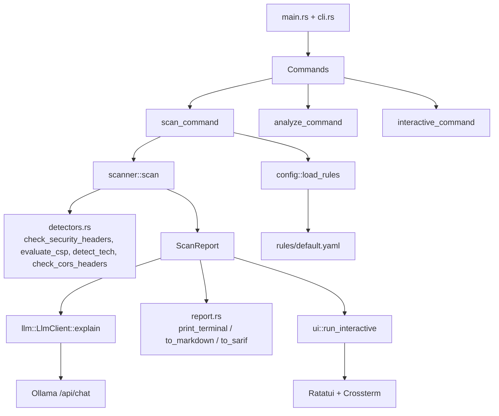

<!-- header:start -->
<div align="center">



<a href="#-quick-start"></a>

<a href="LICENSE"></a>

<a href="https://github.com/ajendras/web-shield/stargazers"></a>
<a href="https://github.com/ajendras/web-shield/actions/workflows/ci.yml"></a>

<a href="CONTRIBUTING.md"></a>

**Rust CLI that passively scans websites for security issues and uses local LLMs to explain risks with concrete fix suggestions**

[✨ Features](#-features) • [⚡ Quick start](#-quick-start) • [🧰 Usage](#-usage) • [🧩 Architecture](#-architecture) • [📍 Roadmap](#-roadmap) • [🤝 Contributing](#-contributing)

</div>
<!-- header:end -->

## ✨ Why Web Shield?

Most security scanners dump raw headers and cryptic codes that busy developers ignore. Web Shield runs a fast passive scan of headers, cookies, CSP, CORS and tech fingerprints, then asks a local LLM (via Ollama) to translate the results into plain-English risk summaries and copy-paste configuration fixes. Perfect for indie hackers, full-stack developers and small DevSecOps teams who want actionable security without enterprise tools or sending data offsite.

- **Actionable intelligence** — local LLM produces plain-English explanations plus exact Nginx/Apache/CSP snippets
- **Zero data leaves your machine** — everything runs offline with Ollama; no cloud APIs
- **Retro terminal UI** — Ratatui-powered interactive explorer with phosphor-green CRT aesthetics, severity filters and Vim-style keys
- **CI/CD ready** — non-interactive mode, JSON/SARIF output, smart exit codes and custom YAML rules

## 🎬 Demo

<p align="center"></p>

## 🚀 Features

<table>
<tr>
<td>
🛡️ <b>Passive Scanner</b><br>
Fetches headers, cookies, CSP and CORS in one request with no malicious payloads
</td>
<td>
🔎 <b>Tech Fingerprint</b><br>
Identifies servers, frameworks and surfaces known CVEs via response headers
</td>
<td>
🧠 <b>Local LLM Analyst</b><br>
Queries Ollama to generate contextual explanations and remediation code
</td>
</tr>
<tr>
<td>
📟 <b>Terminal UI</b><br>
Ratatui-powered interactive explorer with severity filters and drill-down
</td>
<td>
📋 <b>Smart Reports</b><br>
Markdown summaries with ready-to-use header snippets for Nginx/Apache
</td>
<td>
📜 <b>Custom Rules</b><br>
Load organization rules from YAML; extend via Rust traits
</td>
</tr>
<tr>
<td>
🚀 <b>CI Ready</b><br>
Non-interactive mode, JSON/SARIF output and proper exit codes
</td>
<td>
⚡ <b>Blazing Fast</b><br>
Rust + async keeps scans under 400 ms even with LLM summary
</td>
<td>
</td>
</tr>
</table>

## 📦 Installation

**Requirements**

- Rust 1.70+
- Ollama running locally with a model pulled (`ollama pull llama3.2`)

```bash
cargo install web-shield
```

Or build from source:

```bash
git clone https://github.com/ajendras/web-shield.git
cd web-shield
cargo install --path .
```

## ⚡ Quick start

```bash
# Ensure Ollama is running
ollama run llama3.2

web-shield scan https://example.com --model llama3.2
```

This performs a passive scan, calls the local LLM for analysis, prints a retro terminal report and exits with the appropriate code (0/1/2) based on risk score.

## 🧰 Usage

**Basic scan with terminal UI**

```bash
web-shield scan https://example.com --model llama3.2
```

**Save markdown report with LLM explanation**

```bash
web-shield scan https://example.com --model llama3.2 --output report.md
```

**Interactive Ratatui explorer**

```bash
web-shield interactive --url https://example.com --model llama3.2
```

Use arrow keys, `h/l` or Tab to switch tabs, `j/k` to navigate findings, `?` for help, `q` to quit.

<details><summary>Analyze a saved JSON report</summary>

```bash
web-shield analyze scan.json --model llama3.2 --output analysis.md
```

</details>

<details><summary>Custom rules + CI mode</summary>

```bash
web-shield scan https://example.com \
  --rules rules/custom.yaml \
  --ci \
  --output results.sarif
```

The `--ci` flag disables colors/TUI and forces SARIF-friendly output with correct exit codes.

</details>

## 🔧 Configuration

| Option | Default | Description |
|--------|---------|-------------|
| `--model` | `llama3.2` | Ollama model name (must be available locally) |
| `--output` | (none) | Output path (`.md`, `.json`, or `.sarif`); omitted = retro terminal |
| `--rules` | embedded | Path to custom YAML rule file (`rules/default.yaml` is built-in) |
| `--ci` | `false` | Non-interactive mode, no colors, SARIF-friendly output and exit codes |

Rules are defined in `rules/default.yaml` (or any YAML passed via `--rules`) and deserialized into `Rule` structs. See `config::load_rules` for embedded defaults and validation.

## 🧩 Architecture



Web Shield is a modular Rust CLI. A single passive HTTP request feeds pure detector functions; findings are scored, enriched by a local LLM, then rendered via the retro Ratatui UI, markdown, or SARIF. All heavy lifting lives in `scanner.rs`, `detectors.rs` and `llm.rs`; `error.rs` provides unified `thiserror` handling.

## 📁 Project structure

```text
.
├── Cargo.toml
├── rules/
│   └── default.yaml          # Embedded baseline rules (severity, header triggers, recommendations)
├── src/
│   ├── main.rs               # CLI entrypoint, command dispatch, exit-code logic
│   ├── cli.rs                # clap Args, ScanCmd, AnalyzeCmd, InteractiveCmd + URL validator
│   ├── scanner.rs            # async scan() + score calculation; calls detectors
│   ├── detectors.rs          # check_security_headers, detect_tech, evaluate_csp, check_cors_headers
│   ├── llm.rs                # LlmClient::new() + explain() using Ollama /api/chat
│   ├── types.rs              # ScanReport, Finding, Severity, Rule structs
│   ├── report.rs             # print_terminal (retro CRT), to_markdown, to_sarif
│   ├── config.rs             # load_rules() with embedded DEFAULT_RULES + serde_yaml
│   ├── ui.rs                 # Ratatui interactive mode (tabs, keyboard handling, phosphor-green style)
│   ├── error.rs              # Error enum (Io, Http, Llm, InvalidInput, etc.) + Result alias
│   └── (mod declarations)
├── tests/
│   └── test_scanner.rs       # mockito-based integration tests for detectors
├── examples/
│   └── full-scan.rs          # End-to-end example (scan → LLM → reports)
└── README.md
```

## 🧪 Testing

```bash
cargo test
```

Runs unit tests for detectors plus integration tests in `tests/test_scanner.rs` that use `mockito` to simulate HTTP responses and assert correct `Finding`s for missing HSTS, bad CSP directives, insecure cookies, server header disclosure, and tech fingerprinting.

## 📍 Roadmap

<!-- roadmap:start -->
- [x] **v0.1.0** — first release: Passive Scanner, Tech Fingerprint, Local LLM Analyst, Terminal UI
- [ ] Add parallel scanning of multiple URLs with shared rate limiter
- [ ] Include cookie attribute analysis (secure, httponly, samesite)
- [ ] Generate framework-specific fix snippets (Next.js, Django, Rails)
- [ ] Support reading URLs from sitemap.xml or plain text list
- [ ] Interactive follow-up chat with the LLM about any finding
- [ ] Cache responses and LLM explanations in ~/.web-shield/cache
- [ ] Add SARIF upload GitHub Action in the released binaries
- [ ] Implement plugin trait so users can add custom detectors
- [ ] Headless screenshot mode to detect client-side security issues
- [ ] VS Code extension that triggers scans on localhost dev server
- [ ] Weekly CVE database refresh command with offline storage
- [ ] Daemon/watch mode that alerts on security regression for monitored sites

> 🤖 This roadmap is worked through continuously — ideas and PRs welcome!
<!-- roadmap:end -->

## 🤝 Contributing

Contributions are welcome and appreciated! Whether it's a new detector, improved LLM prompt, Ratatui UI polish, or additional output formats, we love PRs.

Please read [CONTRIBUTING.md](CONTRIBUTING.md) and follow our [CODE_OF_CONDUCT.md](CODE_OF_CONDUCT.md). Good-first-issue PRs are especially encouraged — check the issue tracker for “help wanted” tags.

Open a PR against ajendras/web-shield and we’ll review it promptly.

## 📄 License

This project is licensed under either of [MIT](https://choosealicense.com/licenses/mit/) or [Apache-2.0](https://choosealicense.com/licenses/apache-2.0/), at your option. See [LICENSE](LICENSE) for details.

<!-- footer:start -->
<div align="center">

### ⭐ Star history

<a href="https://star-history.com/#ajendras/web-shield&Date"></a>

If **Web Shield** saves you time, a ⭐ helps others find it.

Made with ❤️ by [Ajendra](https://ajendra.info)


</div>
<!-- footer:end -->
